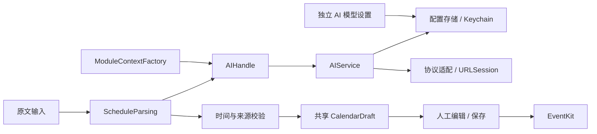
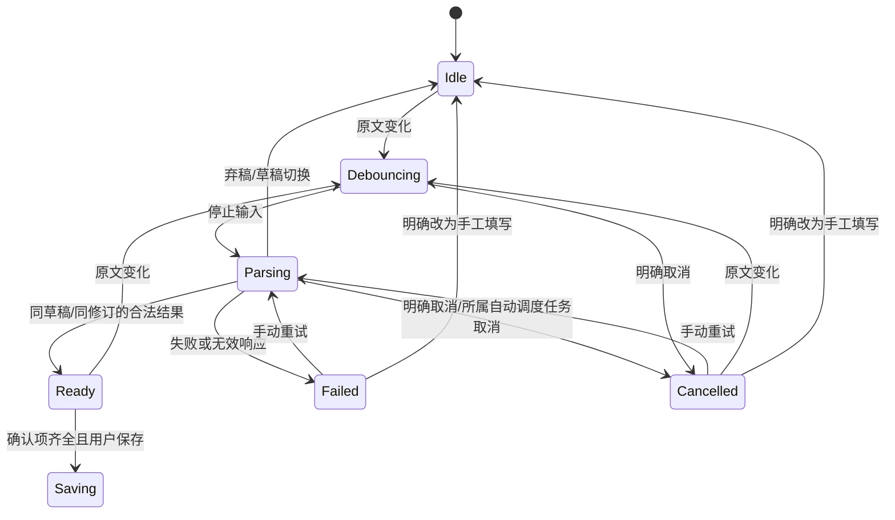

# 通用 AI 与日程输入、复制及会议入口

状态：已接受，实施中；最后更新 2026-10-13。讨论入口为本轮对话；独立计划语义审查零 BLOCKER/零 WARNING，控制器依用户的两道门审核委托记锁。本文为 spec-anchored，交付后继续按代码维护。范围来自用户选择「完整范围」，时间规则来自用户确认的自然语言日程方案。设计档位为重点：新增跨模块服务、凭据保存与异步草稿状态；读者为实现者、审查者及维护者；前五节用于判断方案，「接口与数据形状」用于实现。常规局部细节可自定，改变范围/兼容/保存边界先问，禁止模型自动写入或执行命令。

## 一句话方案

新增独立 AI 配置和模块调用接口，用 AI 把邀请或自然语言填成可确认的草稿；文字复制、会议打开和日历落库由确定性代码负责。

## 背景与目标

承接 [日历轻量交互](39-calendar-light-interactions.md) 的单草稿、保存前校验、受限记录转系统应用及人工界面验收口径。承接 [架构](01-architecture.md) 与 [模块协议](06-module-protocol.md) 的依赖注入；本轮对早期「AI 不投入」决定的增量仅为通用模型服务及日程生成，屏幕助手保持原链。

| 现状 | 交付目标 |
|---|---|
| 首页正文包在导航按钮里 | 拖选与右键复制独立，详情有明确按钮 |
| 两份会议域名匹配、任意替换 scheme | 统一识别、验证打开计划、失败回退 |
| 屏幕助手持有单个活动请求 | 独立通用服务支持各调用者取消与并发 |
| 草稿和待办写链缺少链接/备注 | 生成内容编辑、确认后完整保存 |

## 做法

### 1. 模块与配置

独立设置「AI 模型」管理连接配置、协议、Base URL、模型 ID、文本/视觉能力与默认模型。提供 OpenAI compatible、Anthropic、Gemini、Ollama 协议适配；协议不等于厂商。多个配置互不覆盖。新密钥只写 Keychain，配置只保存引用；测试连接使用当前表单快照，成功不自动保存。屏幕助手既有 Defaults 密钥和模型选择完全不迁移。

AIHandle 只暴露请求/响应及错误，不暴露密钥。默认模型缺失、能力不匹配、非法端点、响应格式异常均返回可读错误。无自动重试、无工具执行；每个请求独立取消。设置和日历分别消费同一服务，其他内置模块经 ModuleContext.ai 获得接口；不扩展第三方插件 RPC 或新增隐式权限。

### 2. 原文输入与草稿状态

新增日程/待办编辑器的多行「用文字生成」区域，提示内容将发送到已配置模型。输入停止约 800ms 后自动解析；可取消或重新解析。只发送此区域文字与参考日期/时区，不发送其他日历内容。模型输出结构化候选，代码检查后逐字段合并，不直接落库。

| 输入 | 草稿行为 |
|---|---|
| 明天下午五点进行周会 | 参考时区下明日 17:00–18:00；无隐含重复规则 |
| 本周四上午开发导出需求 | 本周四日期、标题；具体开始时间标记需确认，保存阻断 |
| 明确起止的会议邀请 | 标题、日期、时间范围、地点/备注、原始链接；保留原文 |
| 日期和「明天」冲突、年份缺失等 | 显示来源警告，要求明确确认日期后保存 |
| 没有明确日期/时间 | 不把编辑器默认 09:00 当解析结果；显示需确认项 |

参考时刻固定在该次原文修订提交解析时，以 IANA 时区与绝对时间传入；起点明确且结束缺省，结束默认加一小时并可编辑。明确全天记录结束为排他午夜。仅给上午/下午等模糊时段而没有具体时刻时，只给日期提示，不补造具体时刻；「周会」不产生 recurrence。用户可切换待办，具体到期时刻、备注、链接同样保存。保存层再次检查未确认项，不能仅依靠按钮禁用。

请求捕获 draftID、原文修订、字段快照及参考时区；只合并自启动以来未手改的字段，过期结果和错误均不得更新新草稿。原文和待确认项属于 CalendarDraft，参与 dirty 比较，切页/自动收回保留；退出本进程不承诺持久恢复。模型请求不是保存请求，等待模型不永久抑制收回；已有编辑焦点/菜单和保存保护继续生效。原文一改即使旧确认失效；debounce/解析/失败期间不能沿用旧确认保存。取消解析保留原文和阻断状态；可明确选择「改为手工填写」后使用当前字段，由用户确认当前日期时间并按手工校验保存。生成备注保留原始输入；用户手改备注后不强行覆盖。弃稿取消任务并清除候选。

### 3. 复制与会议入口

首页及日历列表正文用只读可选文字，导航放独立详情箭头；完成圆圈和加入会议按钮并列，不靠外层 tap gesture。右键提供复制标题、完整信息、会议信息；无日历模块时复制仍有效。拖选期间和自有菜单期间通过独立 owner/token 保护收回，松手/菜单关闭/拆毁/应用离开释放并重新检查 hover；选中文字本身不常驻保护。快捷键旧收回 deadline 同样尊重保护并取消旧计时器。

会议识别集中在 MeetingLinkResolver：严格 scheme、域名边界和平台路径，支持华为云会议、腾讯会议、飞书及现有平台；不使用 host.contains。原邀请 HTTPS 是可靠入口，可以由官方网页唤起客户端。只有原文包含、参数满足验证规则的原生链接可直接打开；打开被拒绝时尝试原 HTTPS。无可验证深链参数时不从会议号拼地址、不任意替换 scheme。

规则找不到明确入口时提供「AI 识别会议」动作；AI 只能返回原文片段中的链接/会议号，由同一解析器核实。多个候选须选择，返回伪造链接须拒绝；没有实际链接仅复制原文明确会议号。华为示例的邀请路径 ID 与标签会议 ID 分别保留，不互相覆盖。打开返回成功只表示系统接受请求，不能表示已加入正确会议。

## 备选与取舍

| 备选 | 选择与原因 |
|---|---|
| 直接重构屏幕助手 | 不采用：用户明确暂不处理，独立配置减少回归面 |
| 把 NLP 全写成正则 | 不采用：普通任务语言也须 AI 参与；规则用于校验而非替代模型 |
| AI 直接创建日程或拼深链 | 不采用：草稿确认和来源验证保留可控写入边界 |
| 首页整行点击加 textSelection | 不采用：仍存在拖选与点击竞争 |
| 新增草稿持久数据库 | 不采用：继承本轮明确的进程内单草稿，避免扩大恢复契约 |

## 接口与数据形状

### 4. 通用服务契约

| 类型/接口 | 约束 |
|---|---|
| public AIHandle.complete(_ request: AIRequest) async throws -> AIResponse | @MainActor 接口，URLSession 异步等待；无全局 activeRequest |
| AIRequest | purpose、messages、可选 profileID、requiredCapability、maxOutputTokens；消息含 role/text 与可选图像数据 |
| AIResponse | text；不含可执行动作、密钥、SDK 厂商类型 |
| AIModelProfile | UUID、显示名、协议、baseURL、modelID、能力；密钥以 UUID 引用，不编码秘密 |
| AIConfigurationStore | 保存非秘密配置；注入 secretStore/传输便于离线测试；失败不报假成功 |
| AIService | 配置解析、能力校验、四协议适配、取消、错误净化；普通请求默认 30s、输出 2048 tokens |
| GeneralAIRuntime / ModuleContext.ai | Kernel/Factory 的共享 composition root，设置与模块消费同一活实例；可注入替身，保留旧初始化调用 |
| SettingsView 通用 AI 导航请求 | 持久可观察的待处理请求接缝，既有窗口/初次打开/重复请求均进入 generalAI 并清理搜索；保留完整设置导航，只有显式按钮才调用原窗口控制器 |

只接受 HTTPS 或 loopback HTTP 端点，禁止用户信息及 fragment；规范拼接协议路径，避免重复 v1。禁跟跨域跳转传递凭据。响应体上限 1MiB、日程原文上限 20,000 字符；错误不回显凭据或原文，不记录请求/响应正文；用户可见错误按 R5 通过本地化 lookup 提供 en/zh-Hans。新 secret 不通过导出配置、日志或 ModuleContext 流出。

### 5. 日历与会议契约

| 接口/字段 | 约束 |
|---|---|
| ScheduleParser / ScheduleParsing.parse(text:referenceDate:timeZone:) async throws -> ScheduleCandidate | @MainActor 可注入解析契约；生产实现调用 AI；候选含标题、日期、可选精确起止、全天、地点、备注、原文 URL、来源时区与 date/time 确认项，不保存 |
| CalendarDraft 新字段 | sourceText、url、timeZoneIdentifier、确认状态；默认兼容手工旧草稿 |
| CalendarPanelSession.parseSource(using:) / cancelSourceParsing() | 单草稿代数与逐字段合并；可注入解析器；取消保留原文和保存阻断 |
| updateSourceText / retrySourceParsing / useManualEntry / confirmSource | 原文改动立即失效旧确认；重试复用该修订成对的参考时刻与参考时区；手工退出仍逐项确认当前 date/time |
| CalendarPanelSession.configuredAI | 只读可选 AIHandle，取自模块实际 configureAI；会议动作使用同一注入对象，视图不另建全局服务 |
| CalendarEventInput | URL 和时区默认可选；编辑加载原值，保存不得清掉既有未知时区 |
| CalendarReminderInput | title/due/isAllDay/notes/url/listID/timeZoneIdentifier；到期时刻换算为绝对时间，并将可用来源时区写入 DateComponents，兼容旧 title/due/listID 调用者 |
| MeetingLinkResolver.resolve(text:) -> [MeetingJoinTarget] | 纯解析、来源可回溯、域名/路径验证、会议号不是电话号码 |
| MeetingOpening.open(_ target:) async -> MeetingOpenResult | 可注入 opener；原生拒绝后 HTTPS 回退，不宣称已入会 |
| CalendarSelectableText / CalendarCopyPayload | 真正的只读 NSTextView 选区；正文、完成、详情与会议动作分离；完整复制保留记录元数据，会议复制仅含验证过的入口和显式会议号 |
| CalendarMeetingEvidence.resolve(textFields:structuredURLs:) | 既有记录按完整 URL token、显式会议号及结构化 URL 验证，不以整段备注的 AI 输入限额禁用复制；不截短 token，超大库存保留全部独立候选且不制造跨片段唯一回退 |
| TodoStore.reminderRecords | 随已有刷新发布完整提醒快照，首页渲染仅做字典查询；旧 reader 无完整元数据时走 Item fallback |

保存延续 EventKit 重新读取及个人可写记录限制，不增加重复会议或他人组织会议的编辑权限。提醒 dueDateComponents 使用完整时分或明确 date-only，不偷偷丢掉已解析时间。

编辑页日期控件与全天转换使用草稿来源 calendar/timeZone，和保存校验一致。提醒时刻按秒精度验证 DateComponents 读回：不能保全绝对时刻时拒绝保存并保留草稿，不用固定偏移悄悄替换来源 IANA 标识。

解析 JSON 必须且只能含 `title/date/dateEvidence/start/startEvidence/end/endEvidence/isAllDay/location/notes/url/timeZoneIdentifier`；缺值为 null，日期为 YYYY-MM-DD，时刻为 HH:mm 或 HH:mm:ss，证据是原文连续片段。不能仅凭模型选中的局部证据消除原文其他日期或时间提示；来源日期须严格回读校验，不能由 Foundation 进位。相对日和本周规则先在请求参考时区求年月日，再于日程来源时区构造该自然日。候选起止共同确定后，使用与选中证据相同的 `timeHints` 词法核对全文时刻：保留 range 的时段继承和 GMT/UTC 偏移排除，不能由模型选择或「改到」措辞推断旧提示已被废弃。任何无法解释或不等于候选起止的独立时刻保留 `.time` 确认；合法两个独立起止不会额外确认，邀请中的日期、会议号和电话沿既有词法处理。证据不足或范围遗漏保留确认；只有原文确实缺结束时间才使用一小时默认。

`sourceText/generationMode/confirmations` 属于草稿 dirty 状态。会话同步失效与保存守卫独立于 T7 的 800ms 调度；`generationState` 为 idle/debouncing/parsing/ready/failed/cancelled。首次提交解析用 `SourceReferenceContext` 成对冻结该修订的 reference instant 与 reference time zone，重试和取消后重试均复用。参考区用于解释相对年月日；候选来源区继续用于显示、日期控件和保存，不得回流改写同修订的参考区。原文变化、载入新稿与清稿统一清除此上下文；新修订重新取当前时刻及当时草稿区（未指定则用会话区）。备注一旦手改便持续由用户持有，重解析不再自动追加原文，独立原文仍可恢复。

文字桥接按建议宽度测量行高，不嵌套 NSScrollView，保留页面外层全量滚动。实际拖选开始和菜单打开各占局部 owner；AppKit 的 mouseDown 跟踪返回、mouseUp、菜单关闭、离开应用/窗口及拆毁释放并复检 hover。快捷收回观察当前选屏，保护开始取消旧 deadline，释放不恢复旧三秒计时。观察安装以 binding ID 防止同步 publisher 回调中的停止或替换被返回的旧订阅覆盖。

自动原文调度由 CalendarSourceDebouncer 持有：延迟中切页取消本地 delay，恢复 debouncing 时重新调度；已开始的自动解析取消则保留 cancelled 与保存阻断，不在恢复时无改动重发。显式手动重试目前由独立 Task 持有，离开编辑页后仍可能在同草稿/同修订下完成或失败；明确取消、原文改变及弃稿依然使其结果失效。两种路径均不以模型等待长期保护收回。

## 明确不做

屏幕助手迁移、第三方插件 AI RPC、自动写日历、后台抓取其他日程、自动入会操作、凭会议号猜深链、联系人或系统设置调查、退出后草稿恢复、远端推送/合并/发布均不在本次范围；不运行旧自动 UI Runner，验证不读取真实秘密、不发真实 AI/会议请求或写真实 EventKit 记录。用户于 2026-10-13 明确恢复宿主测试授权，并授权完整自动门与独立整体审查通过后本地安装本轮构建。四类别 UI 验收留在安装后逐项确认，未确认时工作流不 close；安装本身不代表验收完成。

## 实际交付

T1 初版与修复已本地提交（`5ce6a319`、`2ac90b64`）：通用 AIHandle、独立配置/秘密存储、四协议服务与限额 HTTP 接收，以及 20 个离线测试。修复补齐错误提示 en/zh-Hans、实际传输取消与密钥替换回滚覆盖。T2 已本地提交（`ec660213`）：独立 AI 模型设置、共享 runtime 与 ModuleContext.ai，以及 9 个离线设置/注入回归；34 个新增 UI key 的 en/zh-Hans 完整，旧屏幕助手设置逐字未改。T3 已本地提交（`2d2b6e20`、`26725e5a`）：统一会议识别、来源校验及可注入打开/拒绝回退，21 个离线回归；独立审查发现的 AI 隐藏多候选和配对唯一性问题均修复并复审通过。T4 已本地提交（`a1b81773`、`38f5e322`）：完整日程/待办元数据写链、来源时区编辑、提醒读回校验与正确错误提示，18 个离线回归；跨时区全天和 DST 重复时刻问题均修复，独立源码 helper 的 Foundation 检查退出 0。T5 已本地提交（`abb1c685`、`7458844b`、`8bc1bf39`）：AI 候选解析、草稿异步隔离与保存确认，34 个离线回归；日期/时区/时间证据、本地化及配对链接问题全部修复，独立 Foundation 检查 60 断言零失败。

T6 已本地提交（`a4225282`、`f264c656`）：只读选区/复制菜单、独立详情动作、实际交互保护与选屏快捷计时取消，22 个离线回归。独立初审发现的长备注会议证据过滤、同步订阅重入和首页渲染读取均已修复；复审实际运行源码探针 49 断言、额外证据边界 4 断言和刷新快照 12 断言通过。

T7 已本地提交（`e4e6b953`、`f0a54cad`、`c22e1936`、`9bed9efc`）：原文自动调度与确认/取消/重试、增长输入、精确待办时间、会议操作菜单与通用 AI 设置导航；模块自有会话贯通实际首页/日历界面。新增 14 个 XCTest 当时仅完成编译，现已随下述完整 815 用例运行。独立审查发现的会话断链和邀请提示词界问题均已修复，最后有限复审 Spec/Quality PASS、无未处理问题；Swift 5 源码探针 43、144 及扩展 396 项通过。这些探针使用离线壳，不证明实际 SwiftUI 布局或桌面交互。

T1–T7 增量 build-for-testing 均退出 0，独立任务审查通过。2026-10-13 下述修复前完整自动门实际运行 815 个 XCTest，失败/跳过均为 0，Python 与当时新 Release/签名检查均通过；首次整体终审随后为 No。唯一同波修复 `23c34167` 后已取得下述新完整自动证据（819 个 XCTest），旧成功仍只适用历史源码；最终整体审查、安装和人工验收仍待进行。

### T8 验证入口与交付状态（完整自动门已运行）

五份关联文档、跟踪静态回归 `tests/test_general_ai_configuration.py` 与本轮 ignored `.workflow/ai-calendar/verify.sh` 已实现。wrapper 属本轮工作流证据工具，不作为 fresh clone 必备文件；正常 Python 回归可在没有 `.workflow` 和 `cd825466` 历史对象时运行。静态屏幕助手守卫采用已核实基线内容指纹（manager、selection、Constants 全文件和旧设置区段）；Constants 全文件也锁住无关 Defaults，未来合法修改须重新审核这个守卫基线。locale 使用主 app catalog 的本轮全部 105 个新增/变更 key，包含非 AI 前缀，检查 en/zh-Hans 和有限动态 key 的实际消费来源。

| 入口 | 行为与证据 |
|---|---|
| `bash .workflow/ai-calendar/verify.sh` | 非零拒绝；不启动宿主 |
| `bash .workflow/ai-calendar/verify.sh --self-test` | 纯临时 fixture 正负向证据检查；不证明实际 XCTest/Release |
| `bash .workflow/ai-calendar/verify.sh --verify-evidence` | 缺失/失败/陈旧/不匹配非零；绝不自动重跑或启动宿主，每次重跑静态 guard 和 diff |
| `bash .workflow/ai-calendar/verify.sh --allow-test-host` | **仅取得明确桌面空闲授权后**执行完整门；首次 preflight 失败后修复，新 attempt 总退出 0、十阶段均退出 0 |

完整门每次生成唯一 attempt 和未存在的 xcresult/DerivedData 路径，启动先将 latest 置 running，废止旧成功；按实际进程退出码逐阶段记录完整命令/日志/允许环境/时刻，失败即停止。只运行 DynamicIslandTests，禁并行，隔离 `PRODUCT_BUNDLE_IDENTIFIER=com.cmeng.gourd.calendar-tests.$(PRODUCT_NAME:rfc1034identifier)`，保持项目 `Gourd Local`；测试 profile 写本 attempt，不覆盖原 `default.profraw`。其后运行三个 Python 套件、纯 Release build（无 install/dmg）、Debug/Release 签名检查及 diff。新 Debug app/test bundle、Release app、xcresult 和日志均摘要绑定，不能用旧 app 存在冒充新产物。

Xcode 27 新 summary reader 在只读调研中发生缓存迁移失败；wrapper 显式使用 `xcresulttool get object --legacy --format json` 的 `ActionsInvocationRecord`，核对 root/action 的 testsCount/failed/skipped、succeeded 与非零执行数。legacy 没有独立 passedTests/expectedFailures 字段，记录为缺失而不补造。历史 677 用例不作为本轮计数或通过阈值。

D-18 复核只认可 ai-calendar/cd825466、本轮最新成功 attempt、24 小时内且同本地自然日；绑定当前 checkout 路径、代码/测试/资源/项目/工具（含 wrapper）、SPM lock/实际 checkout revision/内容/dirty 状态及二进制 artifact 内容、公开签名身份与 Xcode/SDK/Swift/macOS 环境、原完整日志和产物摘要。只允许 docs 下 Markdown 回写复用；源码、wrapper、依赖、环境或产物改变须新 attempt，失败/中断不可借旧成功。环境仅记录明确允许的公开构建项，不落盘整个环境、认证配置或真实密钥。离线负向检查使用隔离 fixture，真实成功证据不被修改。

**本次离线实测**：三个 Python 套件共 11 tests，退出 0；本地浅 clone（无 `.workflow`、无基线对象）同样 11 tests 退出 0；wrapper self-test 的 24 个证据 fixture 加真实临时文件/浅仓库 docs-only、源码/lock/ignored tool/wrapper/产物及 legacy schema 检查退出 0；默认入口与无证据复核均退出 1，未启动宿主。

**单独纯 Release 实测（2026-10-13）**：绑定代码 `bd31fc2e`，控制器以允许项环境执行 `GOURD_DERIVED_DATA=/Users/cm/Library/Developer/Xcode/Gourd-ai-calendar-offline sh tools/build.sh -clonedSourcePackagesDirPath /Users/cm/Library/Developer/Xcode/Gourd/SourcePackages -disableAutomaticPackageResolution -onlyUsePackageVersionsFromResolvedFile -skipPackageUpdates`，profile 指向本轮独立 reports 路径，实际进程退出 0、日志含 `BUILD SUCCEEDED`。未启动宿主/应用，也未安装。实际产物为 `/Users/cm/Library/Developer/Xcode/Gourd-ai-calendar-offline/Build/Products/Release/Gourd.app`，arm64，bundle `com.cmeng.gourd`、version `0.2.0`。

签名只读复核保留两种环境的结果：沙盒内 `codesign --verify --deep --strict` 退出 1（`CSSMERR_TP_NOT_TRUSTED`）、display 退出 0 但 Authority unavailable；同一产物在实际本机信任环境 verify/display 均退出 0、`Authority=Gourd Local`。没有导入证书、改变信任或重签来修正沙盒结果。完整日志 `.workflow/ai-calendar/reports/T8-offline-release.log` SHA256 为 `e2595c5fb41bcd60ed0aacc53f29dceafdcd08b9a213e481e4712c0d4cd0f8ef`；Mach-O SHA256 为 `1ac59b4b71b1f28d481cecffe94d7be626dd8b85609ce94933a99d9b2f1b4b19`，CDHash 为 `f897341e8b26019829d6181cb236419dfd11ef7c`。该单独 Release 验证不构成 wrapper 完整成功 attempt。

独立 T8 offline 预审绑定 `9bed9efc..bd31fc2e` 与当时 wrapper 内容指纹，Spec/Quality PASS，未处理实现缺陷 C/I/M 为 0/0/0；实际执行仍须满足下述宿主先决条件。用户先回复「先继续不占桌面的工作」，随后于 2026-10-13 明确要求「现在进行测试验证，验证完安装到本机」，并进一步选择「自动测试与审查通过后安装，界面验收留到安装后」。由此恢复宿主测试许可，完整自动门与独立整体审查通过后执行本地安装，四类别 UI 在安装后逐项确认、未确认不 close；此记录不表示已经测试、安装或人工验收。

控制器即时 Pear 查询 false、退出 0 后启动 attempt `20261013T182253-be28ba0a15484345b4f984ae1ad6aefa`；preflight 将跟踪的 framework `Resources` 目录 symlink 误交给普通文件哈希，失败于 `missing file .../MediaRemoteAdapter.framework/Resources`。阶段列表为空，未启动宿主；该历史 attempt 保留 failed，不冒充后续成功。wrapper 已限定修复输入指纹：逐组件解析 checkout 内链接，绑定链接自身 target、中间链、目标存在性与文件/目录内容；越界、受保护秘密路径、断链和循环拒绝，不能简单忽略 symlink。Git 清单原已包含 `Versions/A` 实际目标数据，修复补齐链接语义与目标内容绑定。纯隔离同型 framework fixture及本工作区 620 项输入快照通过，当时默认/failed latest/隔离缺证据复核均非零；这些不替代宿主测试。修复后的实际 wrapper 指纹经独立有限复审 Spec/Quality PASS、无未处理问题。

**修复前完整自动门历史实测（2026-10-13）**：控制器在实际本机信任环境执行 `sh .workflow/ai-calendar/verify.sh --allow-test-host`，总退出 0；成功 attempt 为 `20261013T183709-1c7a4d116a984b348993cbb011ae4f7c`，绑定源码 HEAD `35307761`、ai-calendar/cd825466 与 wrapper SHA256 `cfaf6bd71ef0ce437bd64b853f8298a031167c39aa42c5d823fb67748f6558ec`，latest 为 succeeded。static/xctest/xcresult/python/release/debug-signature/debug-metadata/release-signature/release-metadata/diff 十阶段均退出 0。新 xcresult 的 root/action 计数一致：实际执行 815、failed 0、skipped 0、actionStatus succeeded；legacy 的独立 passed/expectedFailures 仍为 null。三个 Python 套件实际 11 tests 通过。

本 attempt 的新 DerivedData 为 `/Users/cm/Library/Developer/Xcode/Gourd-ai-calendar/20261013T183709-1c7a4d116a984b348993cbb011ae4f7c`；新 xcresult 在 `.workflow/ai-calendar/evidence/20261013T183709-1c7a4d116a984b348993cbb011ae4f7c/tests.xcresult`。Debug app 使用 `com.cmeng.gourd.calendar-tests.Gourd` 隔离域，其 test bundle、新 Release app 的内容摘要均绑定于同目录 `evidence.json`。Debug/Release deep strict 签名和实际 metadata 检查均退出 0、Authority Gourd Local；Release 为 `com.cmeng.gourd`、0.2.0（build 1200）。该历史 attempt 曾以此新 DerivedData 下 `Build/Products/Release/Gourd.app` 作为待安装源；本波生产/测试修改后旧 success 不可复用，后续安装须绑定本波新的成功 attempt，不使用此历史产物或旧单独 offline Release。各原日志及命令/阶段退出/允许环境/时刻/摘要均已保存，未将编译或旧产物当作本轮运行证据。

控制器实测 Pear 启动前/测试后精确查询均 false、退出 0，测试宿主已退出（TestHosts 空）；未运行旧 UI Runner、安装或真实 AI/秘密/会议/EventKit 写操作。回写前实际 `--verify-evidence` 已退出 0，另重跑 4 个静态回归且没有启动宿主；该修复前文档提交后的 docs-only 实际正向复核随后由控制器完成。

**T8 修复前完整自动证据、任务最终复审及 docs-only 证据复核已取得；首次 fresh 整体终审为 No（Critical 0 / Important 2 / Minor 2）。唯一同波修复后新的完整自动门已通过；最终文档的实际证据绑定、独立整体复审最终判决、安装、四类别人工确认及 engine 收尾尚未完成。** 完整自动门与独立整体审查通过后执行已授权安装，再逐项确认四类别 UI；未确认不 close。本节不宣称全范围验收通过或已安装。

### 首次整体终审与同波修复（2026-10-13）

首次独立整体终审在 `172cc65e` 判定 No；唯一修复波次已本地提交 `23c341671235bb397611a77fdfb84e7f16f61a74`：I-01 的三个独立时刻可被模型选中的局部证据漏掉；I-02 的重试只冻结 instant，候选纽约来源区回流改变上海参考日期。两项均恢复 D-04/D-07/D-15/D-16 原契约，不降为已知可接受限制。该波还校正用户指南的来源区编辑承诺、架构的 CalendarModule/TodosModule 各自 surface 注入描述，不新增时区选择器或改变产品范围。

`ScheduleParsing.swift` 新增全文 `timeHints` 与共同起止的一致性核验；`CalendarPanelSession.swift` 用成对参考上下文隔离重试。新增四个 XCTest 方法覆盖模型选旧/新时刻、漏第三时刻、合法两个独立起止、真实 session 保存零写入阻断及明确确认后的内存保存、三类邀请的 GMT/日期/会议号/电话无误报；真实 session→真实 parser→fake AI 在固定 `2026-10-12T16:30Z`、上海参考/纽约来源下检查两次请求 instant+zone 一致、start 稳定、来源区仍正确，并检查取消重试、新修订及弃稿/新稿的上下文生命周期。既有 range/period/default-duration、手改与 DST 断言保留。

实现者在提交前实际运行纯 Foundation 源码/fake AI 探针 46 断言、Python 三套 11 tests，均退出 0；独立 DerivedData 中 build-for-testing 退出 0（沿项目 Gourd Local，无 identity override），当时仅证明新测试编译。初次沙盒编译 exit 74 与后续编译成功日志保留；这些离线证据不替代下述控制器实际新完整门。

**修复后完整自动门实测（2026-10-13）**：控制器实际执行 `sh .workflow/ai-calendar/verify.sh --allow-test-host`，总退出 0；新 attempt `20261013T192520-101cb7e60c2a4a1799d322d9805ec796` 绑定 source HEAD `23c341671235bb397611a77fdfb84e7f16f61a74`、ai-calendar/cd825466 及同一 wrapper SHA256 `cfaf6bd71ef0ce437bd64b853f8298a031167c39aa42c5d823fb67748f6558ec`，latest 为 succeeded。static/xctest/xcresult/python/release/debug-signature/debug-metadata/release-signature/release-metadata/diff 十阶段均实际退出 0；控制器重核十份原日志 SHA256 与 evidence 一致。新 xcresult 的 root/action 计数一致：819 executed、failed 0、skipped 0、actionStatus succeeded；legacy 不提供的 passed/expectedFailures 仍为 null。四个新增回归已随完整 XCTest 实际执行；三个 Python 套件实际 11 tests 通过。

本新 attempt 的独立 DerivedData 为 `/Users/cm/Library/Developer/Xcode/Gourd-ai-calendar/20261013T192520-101cb7e60c2a4a1799d322d9805ec796`，新 xcresult 在 `.workflow/ai-calendar/evidence/20261013T192520-101cb7e60c2a4a1799d322d9805ec796/tests.xcresult`；Debug app、test bundle、Release app 与 xcresult 摘要均绑定同目录 `evidence.json`。Debug `com.cmeng.gourd.calendar-tests.Gourd`、Release `com.cmeng.gourd`，版本均 0.2.0（build 1200）；Debug/Release deep strict 签名和实际 Authority Gourd Local 检查均退出 0。新门前、开始时及宿主退出后 Pear 精确只读查询均 false/exit 0，TestHosts 已为空；此事实不作为未来宿主运行许可。最终文档只复核此新 attempt，后续安装源须为本新 DerivedData 下 `Build/Products/Release/Gourd.app`，不复用旧 815 attempt 或单独 offline Release。

最终 docs HEAD 的 docs-only 实际正向证据复核、独立整体审查最终判决及安装尚待控制器执行；本节不宣称 Ready to merge 或真实 AI、Keychain、会议、EventKit 写入及 UI 验收通过。四个人工类别仍 pending，按用户选择安装后逐项确认，未确认不 close。

## 已知限制

### 6. 成本、兼容及回退

模型质量和协议兼容性依赖配置端点，声明视觉能力不等于实测每个模型；超限/歧义输出明确失败或等待确认。自动解析仅在原文输入区生效，并用 debounce/取消限制无效调用；取消不能保证服务商已计费请求撤销。禁用通用 AI 或无配置时原手工创建路径可用。

不迁移旧屏幕助手配置，两套设置暂时并存。旧 CalendarDraft/写入调用者保持默认参数兼容。回退到旧版本保留非秘密配置，旧版不消费；新增密钥只由本轮独立配置删除动作管理，不批量删除旧凭据。

T1 实现补充：HTTP 重定向全部拒绝，合法同源重定向也需配置最终端点；Base URL 不支持 query，Gemini 使用 header 密钥和不含斜杠的裸模型 ID。OpenAI compatible/Ollama 可使用无认证服务，已有秘密引用却缺少秘密时仍报错。表单快照测试不隐式读取或保存密钥。秘密替换建新引用、完成后删旧引用，回滚也失败时明确报 rollbackFailed；连续底层存储故障可能留下孤立的新引用，不能冒称事务成功。

T2 实现补充：配置加载失败由共享 runtime 明确保留，修复落盘后须重启应用重新加载。空白密钥输入保留原秘密，清除须勾选独立开关；只有点击连接测试才按表单引用读取秘密。默认模型选择立即保存，profile 表单另行保存；连接测试使用当前表单的短文字探针，成功不保存，也不代表视觉能力已验证。

T3 实现边界：仅华为已核实的原文原生参数可以直接分发；其他平台保留白名单内的 HTTPS 会议路径，不替换 scheme。未知合法路径及 Jitsi 自托管域名可能无法识别。原生与 HTTPS 回退按同平台、同链接标识且双侧唯一匹配，编号不同或匹配歧义保留全部原候选。AI 只能解释原文证据，不能扩展平台白名单或创造会议号、入口；合法 URL 证据返回时保留原文全部可打开候选，不能靠漏提隐藏歧义；只有会议号时提供复制。

T4 保存边界：event 的 nil URL/时区表示未指定，保留原值；本轮不提供清空动作。旧 session 的三参提醒闭包只能承载不含新增元数据的 date-only 输入，否则明确拒绝；生产路径使用完整输入。无日期提醒保留旧入口兼容性。时区接受 Foundation 有效标识，兼容固定偏移；提醒仍保留来源时区。DST 回拨的第二个重复时刻若不能由该时区的 DateComponents 精确读回，会拒绝并要求更换时刻或改为全天；普通亚秒差异按秒精度处理。

T7 界面边界：会议操作菜单可提前查看候选、复制或点击 AI 识别，有真实开始时刻时，实际打开沿用开始前 15 分钟的限制；没有开始时刻的事项不套用虚构的时间门，仍只允许打开通过来源校验的已有入口。单候选也在菜单内明确选择打开。已有长备注的完整合法入口仍按规则识别，AI 单次来源超过 20k 则明确拒绝，不截断重试。同 ID 记录的来源字段或开始时间刷新后，局部会议模型重建并取消旧任务。原文与备注输入随内容增长，共用页面外层滚动；原生与 SwiftUI 编辑焦点聚合，真实拖选与菜单分别持有短期保护。界面仅标明通用设置默认文字模型，不从全局配置推断注入句柄的具体模型名。自动调度与手动重试离页时的任务边界见接口节，实际焦点、滚动与收回效果仍须人工复核。

会议入口的邀请提示采用有限中英词句识别，排除场所和资料复合名词，并保留明确邀请后续动作的表达；未列措辞可能不显示提示入口。可验证链接或带标签会议号另由规则识别。这个显示判断不发送模型请求；原文日程生成仍交由 AI 解析，会议 AI 则由用户点击后处理来源证据。

### 7. 尚须外部验证

凭据测试用替身，不读取真实账户或发送示例邀请。会议打开测试用注入 opener，不打开真实会议。系统接受分发、真实客户端成功加入、跨账户同步及模型供应商线上质量不能由单元测试证明。

宿主运行限制：隔离 bundle/允许项环境不能封锁既有 Pear Desktop 自动切换链；Pear 活跃时会经 localhost 认证取得真实内存 token，这不是 Keychain 读取或仅本地监听。独立预审与控制器已采用运行契约：取得明确桌面空闲授权后，启动前即时只读查询精确 bundle `com.github.th-ch.youtube-music`，保存命令/时刻/退出码与 false；true 或查询失败则不启动。测试期间不启动 Pear、不操作真实设置/控制器/会议入口，结束后再次即时只读核对；历史 false 不可复用。本次实际完整门前后已查询 false/退出 0，这不构成未来运行许可或源码级封锁。该 baseline 旁路由 preflight 与持续空闲条件管理，没有新增生产 guard，wrapper 本身不检测 Pear。既有天气 HTTP、本地 RPC/XPC 监听与 AppleMusic 媒体观察仍可能发生，不宣称全宿主零副作用；它们不等于本轮模型/会议请求。桌面授权不解除真实 AI/秘密/会议/EventKit 写禁令。

## 验收标准

### 8. 可执行证据与人工项

完整 XCTest、Python 回归与 Release 构建通过；测试覆盖四协议请求/响应、配置/秘密失败、取消及并发、伪造会议域名/链接、华为双 ID、打开回退、三类邀请与普通语言、时间确认、草稿手改/过期结果、提醒备注/链接/时间及收回保护。全部采用离线替身，不需要真实模型或真实会议账户。

人工逐项复核：① 首页/列表拖选复制、完成与独立详情；② 输入自动填稿、待确认项、切页收回恢复及失败重试；③ 独立 AI 设置保存/连接测试及屏幕助手原配置仍可用；④ 测试会议入口和拒绝回退。继承 D-26，不将旧自动 UI Runner 当成新强制门；此前因宿主显示窗口先编译，2026-10-13 用户恢复授权后修复前实际执行 815 个 XCTest，唯一整体修复后新完整门实际执行 819 个（含四个新增回归）。人工四项仍按用户选择留在安装后逐项确认，未确认不得宣布全范围验收完成或 close。文档、指南及本轮整体独立终审必须与实际实现一致。

## 决策摘要

| ID | 决策 | 来源与理由 |
|---|---|---|
| D-01 | 完整范围：复制、会议入口、独立通用 AI、自然语言日程/待办生成 | 用户「完整范围」 |
| D-02 | 屏幕助手保持原配置和调用链 | 用户「屏幕助手可以先不动」 |
| D-03 | AI 自动解析原文，人工确认草稿后才落库 | 用户要求直接粘贴自动解析及已确认方案 |
| D-04 | 开始明确缺结束默认一小时；模糊时段需确认；相对日按参考时区；无隐含重复 | 用户「可以」确认时间方案 |
| D-05 | 规则优先，AI 只提取原文证据，确定性打开/回退 | 用户认可会议规则优先、不能打开时 AI 参与 |
| D-06 | 统一模型调用，协议与厂商解耦，独立配置及新 Keychain 引用 | 用户要求其他模块共用；agent 选可测试协议与秘密隔离实现 |
| D-07 | 请求按草稿/修订隔离，保留手改与原文，保存层确认校验 | 承接用户要求的草稿保护及既有会话语义 |
| D-08 | 复制独立于导航，以实际拖选/菜单生命周期释放保护 | 用户问题与已批准轻量处理边界；agent 修交互竞争 |
| D-09 | 单元/Release/人工 UI；宿主测试已恢复授权，完整自动门与独立整体审查通过后本地安装，四类别 UI 留安装后；仍禁止真实 AI/秘密/会议/EventKit 写与旧 UI Runner | 用户 2026-10-13 明确「现在进行测试验证，验证完安装到本机」及「自动测试与审查通过后安装，界面验收留到安装后」；继承 D-26，区分编译与运行，人工项未逐项确认不 close |
| D-10 | 八个纵向任务，部分超过五文件但串行提交审查（T1/T4/T5 包含错误文案 en/zh-Hans 本地化） | agent：跨层字段/设置/保护必须原子贯通；不按文件拆散行为 |
| D-11 | 全部拒绝 redirect、Base URL 无 query、Gemini header 密钥/裸模型 ID、兼容及 Ollama 可无认证、快照测试显式凭据、新秘密引用替换并报告回滚失败 | agent：T1 候选裁定经控制器采用；依赖 D-06 的秘密隔离，代价和配置要求见已知限制 |
| D-12 | Kernel/Factory 共享 runtime，加载错误显式保留；空白密钥保留/开关清除；默认选择立即保存，连接测试为不保存的文字探针 | agent：T2 候选裁定经控制器采用，确保模块下一次请求读取新配置，避免测试与保存混淆；加载失败恢复和视觉验证限制见已知限制 |
| D-13 | 华为原生必填/选填按官方契约验证；HTTPS 回退须同平台/标识且双侧唯一；旧平台保留受支持 HTTPS 路径；AI 证据重过同一白名单并保留原文多入口歧义 | agent：T3 技术候选与独立审查修复经控制器采用，不猜测不同编号的关系，也不从原文之外补入口；平台路径覆盖限制见已知限制 |
| D-14 | 未指定 event 元数据保留；legacy 提醒不能保全则拒绝；来源时区编辑与保存一致；提醒秒精度读回失败明确拒绝 | agent：T4 技术候选与独立审查复现暴露的两处边界经控制器采用，确保元数据和绝对时刻不被静默改变；不能表示的 DST 重复时刻限制见已知限制 |
| D-15 | AI 输出含连续来源证据；全原文校验日期/时段及所有独立时刻，未被共同起止解释的提示保留时间确认；相对日先用参考时区，来源时区只构造时刻；无法证实保留确认，默认一小时须确实无结束提示 | agent：T5 初版及独立审查的离线复现暴露局部证据遗漏、日期进位及跨区问题，控制器采用严格校验与人工确认修复边界；首次整体终审 I-01 暴露独立时刻覆盖遗漏，同波沿既有 timeHints 恢复全文核验，不猜改期语义；未覆盖语法可能增加确认或手工回退，不放宽保存守卫 |
| D-16 | 每修订首次提交解析成对冻结参考时刻与参考时区；手改备注持续归用户；调度在 UI，同步失效与保存阻断在会话 | agent：T5 候选裁定经控制器采用，与第 2 节既有提交时刻契约一致；首次整体终审 I-02 暴露候选来源区回流，同波把参考区与来源区职责分离；同修订重试（含取消后）复用两者，原文变化/新稿/弃稿清理，重试不跨午夜改变含义；手改备注之后不自动追加新原文 |
| D-17 | Unicode decimal 显式规范化后严格回读日期；原文 resolver 认可的完整 HTTPS fallback 不受配对后的 native sourceText 限制 | agent：T5 限定修复与独立离线复核后采用；不扩展非 decimal 字符或未认可入口，任何 URL/query/path 截短仍拒绝 |
| D-18 | 完整自动门取得新桌面授权后实际执行；回写文档后只复核绑定同代码/环境/产物的本轮最新成功 attempt；整体终审/人工确认/engine收尾移至任务后整体门 | agent：控制器解除 T8 验收中 close 自依赖；复用限同工作流/基线、24小时内且同自然日，仅 docs Markdown 可变化，其他输入和产物须匹配；新 attempt 废止旧成功，缺失、陈旧、跨 workflow、不匹配或失败/中断须非零，复核不能自动启动宿主 |
| D-19 | T7 用只读 session.configuredAI 接通会议视图的实际 ModuleContext.ai | agent：控制器定位现有 ai 为 private、叶子视图无 context；补会话只读接口及六文件原子任务，避免默认全局服务绕过模块注入，不增加密钥访问或新请求边界 |
| D-20 | NSTextView 真选区、实际菜单 owner 与跟踪返回兜底；单外层滚动；按选屏取消旧 deadline；完整会议证据独立验证；首页刷新快照；订阅安装处理同步重入 | agent：T6 实现及初审三项修复的技术选择由控制器采用。保护只随实际交互，释放走现有 hover；已有长备注不屏蔽独立入口，单个超限 token 拒绝、超大证据库存不自动跨片段配对；增加快照内存及词法提取同步维护成本。真实桌面效果仍须人工验收 |
| D-21 | T7 增加 SettingsView 单路径的持久导航请求，准确进入已有通用 AI 设置页 | agent：实现者定位 selectedTab 为 private、窗口控制器只有 showWindow；控制器选择保留完整导航和旧窗口，处理首次/已开/重复请求及搜索过滤，避免临时通知丢失或替换孤立表单。七文件原子接线，无旧屏幕助手改动；页面真实效果仍人工复核 |
| D-22 | T7 扩两个模块路径贯通实际 surface 自有 session；首页会议动作独立于唯一 conferenceURL 和日历模块开关 | agent：独立审查定位显式注入模块只配置 owned、content 却构造 shared surface 的断链，不能用生产默认 shared 掩盖。九文件原子修复确保真实模块使用同一 AI 句柄；已有入口/会议号/邀请提示可操作，普通无会议信息记录不加空入口，详情导航仍按模块可用性控制 |
| D-23 | 会议菜单提前可达、有真实开始时刻时打开保留开始前 15 分钟门；来源刷新重建局部模型；长来源规则识别与 AI 限额分离；增长输入共用外层滚动与聚合焦点；默认模型说明不冒充具体模型名 | agent：T7 实现候选经控制器采用，保持既有打开时限及来源/注入真实性。单入口多一步明确打开，内容刷新清局部提示，长源 AI 拒绝但规则入口保留；自动 debouncer 与手动重试分别拥有任务，离页差异按接口节记录，真实交互留人工复核 |
| D-24 | 模块构造可注入 manager/store，默认兼容；真实 content 共用类型明确的 surface 工厂；会议来源开始时间可缺省 | agent：T7 修复须离线验证真实模块内容链，避免访问 EventKit 或依赖 AnyView 私有存储布局。首页无到期时刻/sentinel 不构造虚假开始时刻，有真实远期日期仍保留时间门；没有链接的会议号或邀请提示只供复制/识别，不凭空打开 |
| D-25 | 邀请提示用有限词句识别排除会议室/资料等复合名词，允许明确邀请后接正常动作；不声称语义完备 | agent：T7 独立复审定位中文会议室前缀、英文 meeting/conference room 和中文后续动作的具体反例，控制器选择针对边界修复。提示只决定操作入口，不自动请求/分发；未覆盖措辞可能无提示，来源入口与编号规则以及日程 AI 解析保持独立 |

### 9. 审查记录

实施前做独立计划语义审查；逐任务做独立规格/代码审查；所有改动最后由未参与任务的最强可用模型做整体终审。审查结论与实测证据随后按实际回写，本节不替代测试结果。

### 10. 参考

华为原生参数契约：[Mac Scheme 参考](https://support.huaweicloud.com/scheme-meeting/meeting_22_1219.html)、[旧业务开发示例](https://support.huaweicloud.com/intl/zh-cn/scheme-meeting/meeting_22_1216.html)；腾讯：[链接入会](https://meeting.tencent.com/support-doc-detail/70/index.html)；飞书：[浏览器入会](https://www.feishu.cn/hc/en-US/articles/360049067679-join-a-video-meeting-through-your-web-browser)。这些官方契约支持保留原邀请入口；未核实的客户端参数不作为生成依据。2026-10-13 核对华为 Mac 参考：标准 page 为 joinConfByLink，必填 page/conf_id/name，服务地址、端口、密码和音视频开关为可选；验证现有参数，不补造选填值。
